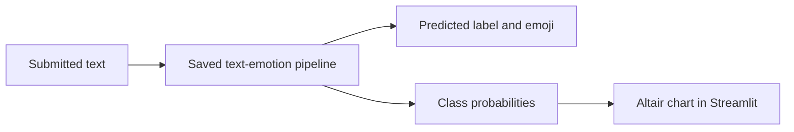

# Text Emotion Classifier

**Explore how a saved text-classification pipeline labels short passages.**

Enter text to see a predicted emotion, an emoji, and a chart of model probabilities. This project demonstrates the final application layer of a text-classification experiment: load a trained pipeline, collect user input, run inference, and explain the output visually.

## Features

- A Streamlit form for text input.
- A saved pipeline loaded from `model/text_emotion.pkl`.
- Predicted emotion and maximum model probability.
- An Altair bar chart showing probabilities across the model's classes.
- A training notebook and an included labeled text dataset.

## Preview


## Architecture



## Run locally

Download and extract the repository. Run from its root so the model path resolves:

```bash
python -m pip install -r reqiurements.txt
python -m pip install streamlit numpy altair joblib
python -m streamlit run app.py
```

The dependency filename is intentionally shown as committed: `reqiurements.txt`. It pins older scikit-learn and Pandas versions, so use a compatible Python environment. The serialized pipeline may require the same library versions used in training.

## Example

Enter a short sentence such as “I am excited to see my friends” and submit it. The app displays the model's predicted label and probability distribution. Those probabilities are model outputs, not a verified measurement of the author's emotional state.

## Repository guide

| Path | Purpose |
|---|---|
| [app.py](app.py) | Input form, inference, and probability chart |
| [Training notebook](emotion%20based%20text%20classifier.ipynb) | Model-development experiment |
| `data/emotion_dataset_2.csv` | Labeled emotion/text data |
| `model/text_emotion.pkl` | Saved inference pipeline |

## Evaluation and limitations

The earlier project notes reported approximately 62% test accuracy. Treat that as a historical experiment note, not a reproduced benchmark: inspect the notebook's split, preprocessing, and environment before comparing results. Dataset class balance and wording can affect predictions. This is an NLP learning demo, not a mental-health assessment tool.

Load pickle-based artifacts only from trusted sources. Contributions that reproduce evaluation and complete the dependency specification are welcome.
